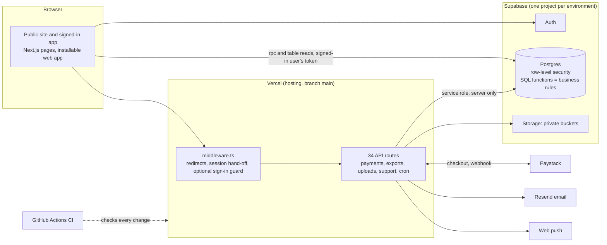
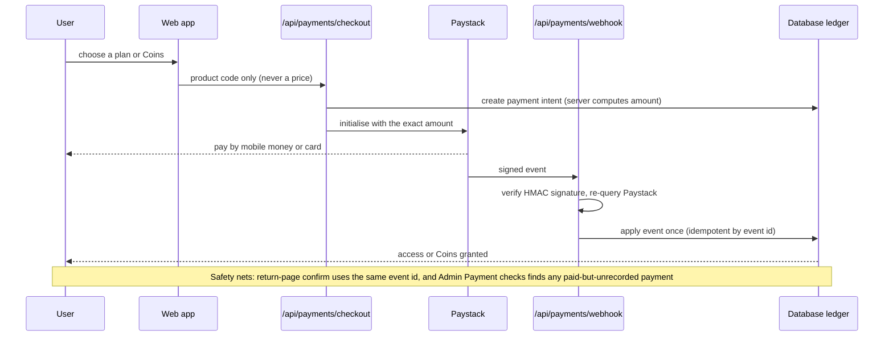

# QuizBox: technical overview for due diligence

Written for: an investor's or acquirer's technical reviewer, and for new support or engineering staff. Written 2026-10-25 from the repository and the production system. Every claim names where it can be checked. Risks are stated as plainly as strengths; the full list is in section 9.

## 1. What it is

QuizBox is a curriculum-aligned learning, assessment and competition platform for Primary, JHS and SHS learners in Ghana, built so other countries and curricula can be added. Learners practise and take assessments, teachers set and mark work, schools see outcomes, sponsors run challenges and competitions, subject experts review questions, and staff run it from admin screens. It also sells subscriptions, Coins, and (switched off for now) a marketplace where verified teachers sell question sets (60 % to the teacher, 40 % to QuizBox). Live at https://www.quizbox.io.

## 2. Architecture

| Fact | Where to check |
|---|---|
| Stack: Next.js 15, React 19, TypeScript 5.8 strict, Supabase (Postgres, Auth, Storage), Vercel, Paystack | `package.json`, `tsconfig.json` |
| 112 pages, 34 API routes | `app/` |
| 119 migration files, 64 rollback scripts, about 140 table definitions, about 265 callable database functions | `supabase/migrations/`, `supabase/rollback/`, `docs/api/MOBILE_API_CONTRACT.md` |
| Two Supabase projects: Production `fmgccmqxfjppqydkhaiu`, Preview `fngdtxayfoiffbcbmcum` | `README.md`, `docs/release/FINGERPRINT_HISTORY.md` |
| About 1,460 automated tests in 182 files; database tests run on a real Postgres engine (PGlite) | `npx vitest run`, `.github/workflows/ci.yml` |

**Design choice that matters to a reviewer:** business rules (prices, scoring, who may do what, ledger entries) live in the database as functions called by the browser or the API routes, with the rules enforced where the data is. The web tier is thin. This keeps rules testable in one place and makes a future native app a client of the same functions (`docs/api/MOBILE_API_CONTRACT.md`).

## 3. Roles and access

| Role | What they can do |
|---|---|
| Student, Teacher, Sponsor | Own screens by role; teachers also have classes, assignments, and (verified) a seller area |
| School admin | School-level views and class management |
| Subject matter expert (reviewer) | Reviews questions assigned to them |
| Admin / Owner | Admin screens, filtered by capability flags: super admin, finance admin, content admin, support |
| Managed learner (under 13) | Created by a teacher, no email, cannot pay (`docs/security/UNDER_13_DESIGN.md`) |

Access is enforced in three layers: (1) **the database** (row-level security and checked functions) is authoritative; (2) the app shell redirects by role (a convenience only); (3) an optional server-side sign-in guard in `middleware.ts` (built and tested, off for now: `docs/release/SERVER_GUARD.md`). The browser holds only the signed-in user's token; the all-powerful service key never leaves the server.

## 4. Learning data flow

```mermaid
flowchart LR
  A[Curriculum source<br/>approved, immutable] --> B[Curriculum structure<br/>indicators]
  B --> C[Questions<br/>written outside the app, checked by script]
  C --> D[Staging, then admin loader]
  D --> E[Expert review or owner-approved batch]
  E --> F[Approved question bank]
  F --> G[Attempt created<br/>question snapshot frozen]
  G --> H[Answers saved<br/>server]
  H --> I[Server scores from the snapshot]
  I --> J[Results, mastery, reports, XP]
```

Scoring is server-side from a frozen snapshot, so a learner or a later edit cannot change a past result. Detail: `docs/blueprint/DATA_FLOW.md`. Content status today (pilot): about 1,225 approved questions and 9,654 curriculum indicators mapped; no Primary learners yet (the public home page shows these figures live).

## 5. Payment flow

- **Price integrity:** the browser sends a product code; the server reads the price and sends Paystack the exact amount.
- **Exactly-once:** the same event id is used by the webhook and the return-page confirm, so a replay grants once (`lib/payments/settlement.ts`, tests `payments.test.ts`, `confirm.test.ts`).
- **Refunds:** a refund reverses the entitlement or Coins; the marketplace share is taken back (`qb_mk_reverse_purchase`).
- **Marketplace money (off):** each sale splits 60/40 in pesewas, the teacher's share is held 7 days, payouts are requested by the teacher, approved by the teacher on a quote of "sales less 40 %", and paid by finance by hand within 24 hours on working days. Automatic payouts are not built.
- **Minimum online charge** GHS 5 (Paystack fees).

## 6. Security controls

| Area | Control | Evidence |
|---|---|---|
| Authorisation | Row-level security on user data; elevated functions pin their search path and state their grants; a test fails a migration that forgets either | `lib/core/migration-hygiene.test.ts` |
| Secrets | Service key, Paystack, email and cron secrets only on the server; `.env.*` ignored by git; secret comparisons are constant-time | `.env.example`, `lib/security/secret.ts` |
| Payments | HMAC-verified webhook, server re-query, idempotent settlement, server-computed prices | section 5 |
| Abuse limits | Per-user call budgets inside the database; per-device counters; upload size and zip-bomb limits; PDF page and time limits | `quizbox_private.enforce_budget`, `lib/uploads/zip-guard.ts` |
| Browser protections | HSTS, no framing, no MIME sniffing, strict referrer policy, restricted permissions; **Content Security Policy is report-only**, with a tested one-setting switch and a decision rule | `lib/security/headers.ts`, `docs/ops/CSP_ENFORCEMENT.md` |
| Children | Under-13 accounts are managed by a teacher, have no email and cannot pay; erasure is automated | `docs/security/UNDER_13_DESIGN.md`, `/api/cron/managed-erasure` |
| Audit trail | Admin actions, exports and manual payment settlements are written to the audit log | `quizbox_core.audit`, `docs/release/PAYMENT_CHECKS.md` |
| Dependencies | Advisory check in CI on every change; weekly Dependabot pull requests | `.github/workflows/ci.yml`, `.github/dependabot.yml` |
| Independent review | An independent audit register (17 findings, all triaged) and a product-experience audit (33 items) | `docs/audit/audit-findings.csv`, `docs/ux-audit/08_PRIORITIZED_DEFECT_REGISTER.csv` |
| Disclosure | Written policy and channel | `SECURITY.md` |

## 7. How change reaches production

1. A branch and a pull request; CI runs the type check, lint, all tests, a production build and the dependency advisory check (`.github/workflows/ci.yml`); code owners review sensitive paths (`.github/CODEOWNERS`).
2. Database changes are migrations applied by hand to **Preview, then Production**, each with an undo script. A read-only **fingerprint** run on both projects proves they match, and each result is recorded (`docs/release/FINGERPRINT_HISTORY.md`); a monthly issue reminds the owner (`.github/workflows/monthly-checks.yml`).
3. `main` deploys to production on Vercel; an instant rollback is documented (`docs/ops/INCIDENT_RUNBOOK.md`).
4. Paste-ready SQL parts, a copy list and a manifest make a release repeatable by a non-engineer (`docs/release/`); tests keep those artefacts in step with the migrations.

## 8. Operations and support

Runbook with first checks and rollback (`docs/ops/INCIDENT_RUNBOOK.md`); admin screens for payment checks, support requests, data exports (31 datasets with date and category filters, `/admin/exports`), platform operations and client-error reports. Browser errors are reported to `/api/ops/client-error`; failed attempt starts, saves and completions are reported to the operations log.

## 9. Open risks (stated honestly)

| # | Risk | Severity | What closes it | Owner |
|---|---|---|---|---|
| 1 | **Signed-in screens have no automated end-to-end tests.** Rules are tested at the database and logic level, but about 87 of 112 screens were only verified by unit tests and code review | High | Seed per-role accounts on Preview and add a Playwright smoke suite to CI | Engineering |
| 2 | **Hosted Preview builds fail** (environment variables are branch-limited), so changes reach production without a Preview run | High | Fix the Preview variable scope in Vercel | Owner |
| 3 | **Database history is partly hand-applied.** Migrations are pasted; history was reconciled after drift; a few objects exist only in production | Medium | Record every migration in the history table; keep the monthly fingerprint; periodically rebuild a scratch database from the migrations | Engineering |
| 4 | **Content Security Policy not yet enforced** | Medium | Follow `docs/ops/CSP_ENFORCEMENT.md` after at least 7 clean days (earliest 2026-10-31) | Owner |
| 5 | **Type looseness:** about 190 uses of `any` remain in application code (down from 250; the five largest screens and the API layer for them are typed) | Medium | Continue typing the API layer module by module; generate database types | Engineering |
| 6 | **Repeated identity look-ups:** 16 pages repeat the sign-in and profile requests the shell already made (UX-013) | Low to medium | Share the shell's identity through a context | Engineering |
| 7 | **Single-person knowledge.** Documentation reduces but does not remove this | Medium | Second reviewer on sensitive paths; handover rehearsal using `CONTRIBUTING.md` | Owner |
| 8 | **Legal and tax:** Terms of Use, seller terms and the tax treatment of QuizBox's 40 % share and teacher payouts have not had lawyer review; the repository licence is a default proprietary notice | High before marketplace launch | Review by a lawyer qualified in Ghana; confirm data-protection registration requirements | Owner |
| 9 | **No independent penetration test** has been done; the audit register is a code and configuration review | Medium | Commission a scoped test before large-scale launch | Owner |
| 10 | **Manual payouts** and **manual migration application** do not scale beyond pilot volume | Low now | Automate payouts and migrations when volume justifies it | Engineering |
| 11 | **Dependency posture:** CI blocks high advisories in production dependencies; development-tool advisories were open at last review | Low | Dependabot plus the monthly checklist | Engineering |
| 12 | **Backups and restore.** Restore tooling and a verification script exist (`scripts/verify-restore.ts`, `scripts/restore-isolated.ps1`); the Supabase plan's automatic backup settings and the last restore test date should be confirmed and recorded | Medium | Owner records plan, retention and the last successful restore test | Owner |

## 10. What a reviewer can verify in an hour

| Check | How |
|---|---|
| Code health | `npm ci`, then `npx tsc --noEmit`, `npx eslint .`, `npx vitest run`, `npm run build` (the same as CI) |
| History and review practice | `git log`, the pull request template, `.github/CODEOWNERS`, CI runs on GitHub |
| Database parity | `docs/release/FINGERPRINT_HISTORY.md` and `docs/release/db_fingerprint_*.sql` (read-only) |
| Money safety | `lib/payments/*.test.ts`, `docs/release/PAYMENT_CHECKS.md`, the Marketplace SQL tests in `lib/core/marketplace-sql.test.ts` |
| Security posture | sections 6 and 9, `SECURITY.md`, `docs/audit/` |
| Product quality | `docs/ux-audit/` (13 reports, 33-item register with status), the live site |

## 11. Document map

`README.md` (start), `CONTRIBUTING.md` (how to work), `SECURITY.md`, `LICENSE`, `docs/ops/` (incident runbook, CSP), `docs/release/` (apply guides, manifest, copy lists, fingerprint history), `docs/blueprint/` (architecture decisions and data flow; the architecture note there is dated 2026-10-14 and predates payments and the marketplace: this page supersedes it), `docs/roadmap/` (progress and plan), `docs/ux-audit/` (product-experience audit), `docs/audit/` (security audit register), `docs/api/` (client contract).
