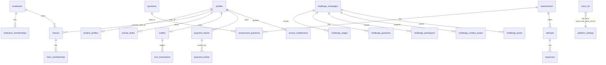

# Database entity map (selected, from migrations and tests)

Not exhaustive: 98 public tables exist. Relationships below are the ones the application relies on; foreign keys were not individually verified against a live database.

Curriculum hierarchy: `curriculum_authorities` > curricula (per market and level) > `curriculum_nodes` (strand, sub-strand, indicator; unique on curriculum and identity key) > questions mapped to indicators.
