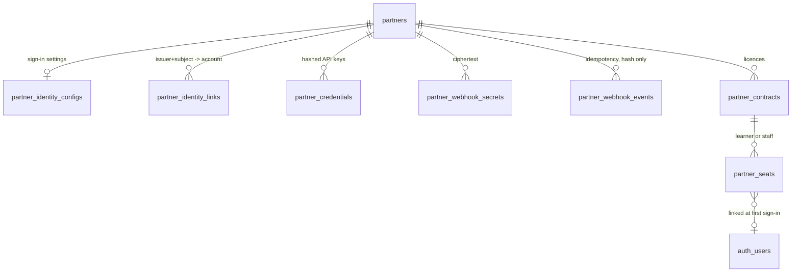

# QPAG: admin UX specification and database schema

## Admin UX (`/admin/partners`, super admin only)
Navigation: **Markets & organizations > Partner Integrations**. Server authorisation is in the database (every function checks `quizbox_core.is_staff(['super_admin'])`); hiding the menu is a convenience only.

| Area | What it does |
|---|---|
| Gateway switch | Shows ON/OFF for `flags.partner_access_gateway_v1`; switching on needs a confirmation tick; owner or super admin only (database checks) |
| Directory | Table of partners with status, sign-in state, contracts, seats in use against live capacity, failed events. "Add partner" form |
| Partner header | Status pill and one box for the evidence or reason; Verify, Suspend, Revoke (revoking ends keys and sign-in for good, with a confirm) |
| Contracts | Create a draft (package, dates, seats, invoice reference, staff seats yes/no) > Submit > Approve with a note (a second person approves what you created; owner excepted) > Suspend / Reinstate / Cancel / Amend (never below seats in use) > reconciliation state |
| Seats | Per contract: partner reference, kind, status, has signed in, allocated time. No names or e-mails |
| Sign-in setup | Three-step wizard: register the redirect address; enter issuer, client ID, endpoints, keys address, client secret, e-mail domains, learner provisioning; save as draft or activate |
| Keys and events | Issue API keys with scopes and life; rotate (24 h overlap) and revoke; create or rotate the event signing secret. Secrets are shown once in a banner and are never retrievable |
| Delivery log | Events with status, tries and reason; "Allow retry" for failed and dead-letter events |
| Audit | Every staff and partner action (no secrets) |

States: empty ("No partners yet", "No contracts yet", "No seats allocated yet"), loading, error banners in plain words, disabled buttons until required notes are filled. No invented metrics: every number comes from the database.

Partner entry page `/partner/<name>`: QuizBox brand shell, partner name, "Continue with <name>", plain error messages for each failure, not indexed.

## Data model (ERD)

| Table | Key points |
|---|---|
| `partners` | name, kind (school, company, other), country, slug, status (draft, pending_verification, verified, suspended, revoked) |
| `partner_identity_configs` | OIDC issuer, audience, endpoints (https only), JWKS, allowed domains, auto-provision flag, client secret ciphertext |
| `partner_identity_links` | unique (issuer, subject) -> user; revoked on seat revoke |
| `partner_credentials` | prefix, SHA-256 hash, scopes, expiry, last used |
| `partner_webhook_secrets` | AES-GCM ciphertext made by the application; one active + one retiring |
| `partner_webhook_events` | unique (partner, event id), payload SHA-256, status received/processed/failed/dead, attempts |
| `partner_contracts` | capabilities (practice, assignments, assessments, staff), dates, `max_seats`, status, external billing reference, reconciliation, approver and note |
| `partner_seats` | contract, partner, external reference, kind, user, status; unique active reference per contract |
| `partner_rate_buckets` | shared counters for the API and sign-in limits |

All tables have row-level security enabled and no browser grants. Access to learner functions flows through `qb_has_subscription()` (learner seats only).
