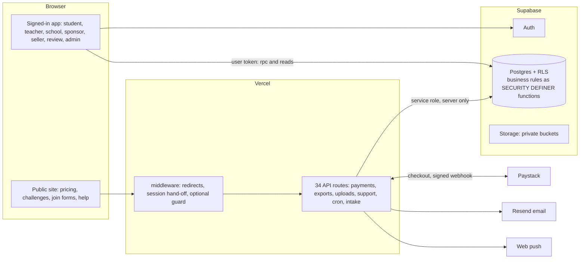

# 01. Current-state audit (Phase 0 baseline)

Date: 2026-10-25. Method: read the repository, schema, routes, tests and existing audits; ran the type check and the full automated suite. **Nothing in this document was inferred from a button or a page title.** Each row names where it can be checked. Where a thing could only be read in code and not exercised (signed-in browser journeys, live payments, production settings), it is marked **NOT VERIFIED** and says why.

Previous reports (the October system audit, the UX audit, the diligence overview, the roadmap tracker) were used as leads and re-checked against code. Where they disagree with code, code wins and the difference is noted.

## 0. Headline

QuizBox is a working, tested learning, assessment, challenge and marketplace platform, not a prototype. **Four of the seven target engines already have a real base** (Learn, Challenges, Marketplace, and the Coins/payments core). **Three have none:** Affiliates, Regional Growth (field sales) and the Legacy/Alumni parts of Sponsorship. School subscriptions exist only for individuals, not for institutions. The honest summary:

| Target engine | Base in code today | Verdict |
|---|---|---|
| 1 Learn | Curriculum tree, question governance, practice, assignments, mastery, server scoring | **Implemented** (signed-in journeys not browser-verified) |
| 2 School | Institutions, memberships, classes, teachers, school pages; **no institution payer, licence, seat limit or school onboarding workflow** | **Partial** |
| 3 Challenges | `challenge_campaigns` (challenge and competition formats), rounds, prizes, awards, seats, moderation, studio; sponsor-competition engine built but gated off | **Implemented, extend** |
| 4 Sponsorship | Sponsor role and organisations, sponsor-competition engine, public intake form; **no CRM, contracts, funding, restricted budgets, alumni, legacy/memorial programmes** | **Partial / mostly absent** |
| 5 Regional Growth | Ghana region/district text columns on `institutions` only | **Absent** |
| 6 Affiliates | Coins ledger exists; **no affiliate, referral, attribution or commission code anywhere** | **Absent** |
| 7 Marketplace | Seller verification, items, 60/40 split (configurable), holds, ledger, payouts by hand, refunds | **Implemented, flag off, teachers only** |

## 1. Authoritative repository and deployment

| Question | Answer | Evidence |
|---|---|---|
| Active repository | `Quizboxdev/app` on GitHub, local folder `Codes/QuizBox_Batch1_Student_Teacher_Assessment` | `git remote -v` |
| Deployed code | Vercel project `quizbox`, branch `main` → https://www.quizbox.io | `docs/DILIGENCE_OVERVIEW.md` §7; Vercel deployment list checked 2026-10-24 |
| Revision that matches production | `0986fdb` was released and verified live on 2026-10-24. Local branch `release/diligence-readiness-2026-10-25` adds `a511088` (not yet merged to `main` as of this audit) and uncommitted pricing-button work | `git log`, `git status` |
| Databases | Production `fmgccmqxfjppqydkhaiu`, Preview `fngdtxayfoiffbcbmcum`; schema fingerprints matched, all checks "ok" on both, 2026-10-24 | `docs/release/FINGERPRINT_HISTORY.md` |
| Sibling folder `QuizBox_Batch2_Admin_Marketplace_Competition` | A **code drop, not a repository**: 12 pages, no SQL, no `.git`. Its own README says it was "designed to be merged into the Batch 1 project". Treated as **legacy; already merged** (the older `marketplace_*` tables are mentioned in the migration `20261043100000` header as left in place) | folder listing, `README_BATCH2.md` |
| Other folders (`QuizBox_Superbase`, `scratch`, `_work`, `Questions Bank`, `Images`) | Content-factory working files and scripts, not application code. They show as untracked/modified in git and **must never be committed wholesale** | `git status`, `scripts/release/make_release_kit.py` SKIP list |
| Google Sheets / Apps Script | Referenced only as a data source for ~17,000 legacy questions awaiting triage (`docs/IP_PROVENANCE.md`, ADR-001 rule 5). Not a system of record | `docs/blueprint/ADR-001-extension-boundaries.md` |
| Prisma | **Not present** (no `prisma/` folder, no dependency) | `package.json` |

Uncommitted work is preserved. This audit created only `docs/quizbox-transformation/*`.

## 2. Confirmed technology stack

Next.js 15.5 (App Router), React 19, TypeScript 5.8 strict, Supabase (Postgres with RLS, Auth, Storage), Vercel hosting, Paystack for payments (mobile money and card), Resend for email, Web Push, Vitest 4 with PGlite for real-Postgres database tests, GitHub Actions CI, Dependabot. Source: `package.json`, `tsconfig.json`, `.github/workflows/ci.yml`.

Business rules live in the database (about 265 callable functions, 119 migrations); the Next.js tier is thin. This is the single most important architectural fact for the transformation: **every new engine below should be built the same way** (tables plus checked SQL functions plus RLS, with Next.js pages and routes calling them), so the new work matches the old.

## 3. Architecture diagram

## 4. Database and service dependency map

Schemas: `public` (user-facing tables and RPCs), `quizbox_core` (settings, flags, audit, wallet/coin posting), `quizbox_market` (markets, readiness), `quizbox_sources` (curriculum source registry), `quizbox_factory` (question-generation jobs, **not** the same as a competition "campaign"), `quizbox_competition` (sponsor-competition engine), `quizbox_sme` (reviewers, pool, earnings, capabilities), `quizbox_topic`, `quizbox_ops`, `quizbox_private` (intake, budgets).

| Domain | Principal objects | Migration |
|---|---|---|
| Identity | `profiles` (role enum student/teacher/admin/sponsor), `user_capabilities`, `user_workspace_context`, `qb_my_roles`, `qb_switch_workspace` | 20260926…, 20261002200000, 20261007100000 |
| Guardian / sponsor links | `account_relationships` (guardian, sponsor, institutional; consent status; funding and progress flags), `learner_consent` | 20261007100000 |
| Institutions | `institutions` (name, code, region, district, ownership), `institution_memberships` (student/teacher/admin/owner), `tenant_memberships`, `classes` | 20260926180522, 20261003200000 |
| Curriculum | `curricula`, `curriculum_nodes`, source registry, topic registry | 20261001…, 20261006…, 20261012… |
| Questions | `questions` (+ versions, origin, validation status), review events, SME pool, compensation | 20261002…, 20261012… |
| Learning | attempts, snapshots, mastery, XP, `qpoint_transactions`, `badge_definitions`, `user_badges`, `user_streaks` | 20261001…, 20261007… |
| Money core | `wallets`, `coin_transactions` (immutable), `access_entitlements`, `payment_intents`, `payment_events`, `price_list`, `refund_cases` | 20261007…, 20261019110000, 20261030…, 20261035… |
| Challenges | `challenge_campaigns`, `_stages`, `_questions`, `_attempts`, `_participants`, `_prizes`, `_awards`, `_reports`, seat limits | 20261021…–20261029…, 20261041… |
| Sponsor competition | `quizbox_competition.*` (sponsor organisations, documents, drafts, bank, snapshots, participations, official results) | 20261002220000–20261002270000 |
| Marketplace | `mk_sellers`, `mk_items`, `mk_questions`, `mk_purchases`, `mk_ledger`, `mk_payouts` | 20261043100000 |
| Support / policy / help | support requests, policy CMS, help centre, exports | 20261036…–20261046… |

Payment dependency chain (read from code): browser sends a product code → `/api/payments/checkout` → `qb_payment_intent_create` (server computes amount) → Paystack initialise with exact amount → signed webhook `/api/payments/webhook/paystack` (HMAC-SHA512, constant-time compare, server re-query) → `qb_payment_apply_event` (idempotent by event id) → `fulfilAfter()` in `lib/payments/settlement.ts` calls `qb_fulfil_subscription_payment` and `qb_mk_fulfil_purchase`; refunds call the matching reverse functions. **`fulfilAfter()` is the one place every settled or refunded payment passes through. It is the right and only hook for commissions.**

## 5. Module inventory: classification of the 23 capability areas

Legend: **IV** implemented and verified (by automated test and, where noted, owner or live check) · **ID** implemented but defective · **PI** partially implemented · **UI** UI only · **NI** not implemented · **BV** blocked or not verified.

| # | Capability | Class | Evidence and notes |
|---|---|---|---|
| 1 | Student registration and sign-in | **IV** (code, tests); signed-in browser flow **BV** | `app/login`, `app/onboarding`, `lib/auth/*`; password policy `docs/security/password-policy.md`; roadmap A10 (real learner sign-up) still TODO |
| 2 | Guardian / parent accounts | **PI** | Schema and RPCs exist (`account_relationships`, `qb_relationship_request/decide`, `lib/api/core.ts`). **No screen calls them** (grep of `app/`, `components/` finds no consumer). `parent_guardian` role routes to `/student`. Flag `flags.guardian_consent_required` default false |
| 3 | Curriculum and grade selection | **IV** | Practise builder and Learn; owner verified 2026-10-12/13 (PROGRESS change log) |
| 4 | Subjects, strands, sub-strands, standards, indicators | **IV** | Primary 1,012 indicators (GH-SBC-2019), JHS 1,302 (GH-CCP-JHS), SHS 2,585 (GH-SHS-2023); loader `qb_curriculum_nodes_import` |
| 5 | Question generation and ingestion | **IV** | File-based loader `qb_question_load`, checker `scripts/check-question-file.ts`; API generation adapter built but deliberately off (owner decision 2026-10-10) |
| 6 | Validation, review, publishing | **IV** | Review workbench, SME pool (`qb_sme_pick`), owner batch approval; approved ≠ published |
| 7 | Practice and assessments | **IV** (logic, DB tests); live signed-in **BV** | `qb_start_attempt`, `qb_complete_attempt` (server scoring from a frozen snapshot) |
| 8 | Classroom creation and management | **IV** (code) | `app/(app)/teacher/classes`, `school/classes` |
| 9 | Teacher assignments and marking | **IV** (code) | `teacher/assignments`, `by-topic`, `gradebook`, `submissions/[attemptId]` |
| 10 | School registration and administration | **PI** | Public form only records interest ("set up by QuizBox after review", `join/school`). School admin screens exist (`school/*`). No self-registration, verification workflow, institutional subscription, licence or seat limit; `plans.test.ts` asserts the school plan is **not** online-sellable |
| 11 | Challenges and competitions | **IV** (DB tests) | Rounds (`challenge_stages`, advance top-N), prizes and awards with fulfilment states, seat caps, moderation, share links; sponsor-competition engine built and gated off |
| 12 | Leaderboards and achievements | **PI** | Leaderboards in competition/play pages. Badge tables exist; achievement awarding not traced end to end |
| 13 | XP, points, Coins | **IV** | `qpoint_transactions`, `coin_transactions` (immutable), `qb_coin_spend`; kept as separate concepts as the directive requires |
| 14 | Subscription packages and entitlements | **IV** | `price_list` (Coins × unit price enforced), `access_entitlements`, ladder 5/10/25/90 Coins |
| 15 | Checkout, payment verification, renewals | Checkout and verification **IV** (unit and DB tests, mocked provider); live payment **BV**; **renewals NI** (fixed-term purchases, no recurring billing) | `lib/payments/*`, `app/api/payments/*` |
| 16 | Teacher and SME functions | **IV** for review pool and compensation policy; SME payout batches **PI** (`sme_payout_batches` exist; roadmap R6/R8 TODO) | `quizbox_sme.*` |
| 17 | Marketplace and creator monetisation | **IV** (code, 20+ DB tests); **flag off**; teachers only | `mk_*`, `qb_mk_split`, 7-day hold, hand-paid payouts |
| 18 | Sponsorship registration and administration | **PI** | Sponsor role, `sponsor_organizations`, intake form, sponsor workspace. No CRM, proposals, contracts, funding verification, restricted budgets, brand approvals |
| 19 | Notifications and communications | **IV** (code) | in-app bell, web push, email via Resend |
| 20 | Platform administration and reporting | **IV** | ~30 admin pages; 31 export datasets (verified on Production, 2026-10-24) |
| 21 | Public marketing pages and lead forms | **IV** | `InterestForm` → `/api/public/intake` → `quizbox_private.public_interest_submissions` with a rate budget. (An earlier report of "non-functional forms" is **not** supported by the code) |
| 22 | Responsive UX, accessibility, SEO, performance | **IV** for public pages (34 pages axe-clean, verified live 2026-10-24); signed-in **BV** | `docs/ux-audit/` |
| 23 | Documentation, support, testing | **IV** | 183 test files; runbooks; user guides in `docs/ux-audit/11` |

## 6. Verified user journeys (what was actually exercised)

| Journey | Evidence | Status |
|---|---|---|
| Public pages render, are accessible, cached | Playwright sweep on production 2026-10-24: 34 pages axe-clean | **PASS** |
| Pricing page shows Subscribe on priced plans | Component tests (4) plus ladder tests; **not yet deployed** | PASS (unit); live NOT RUN |
| Payment settlement idempotency, signature check, price integrity | `payments.test.ts`, `confirm.test.ts`, `reconcile.test.ts`, route test | PASS (unit, mocked Paystack) |
| Marketplace sale → split → hold → payout → refund | `marketplace-sql.test.ts` on PGlite | PASS (database level) |
| Challenge seats, join caps | `challenge-seats-sql.test.ts` | PASS (database level) |
| Signed-in learner, teacher, school, sponsor, admin screens in a browser | Supplied test logins rejected on Preview; assistant may not type passwords on production | **BLOCKED** |
| Live Paystack payment, webhook delivery | No Paystack sandbox run recorded in repo | **NOT RUN** |

## 7. Broken journeys and missing integrations

1. **Guardian journey is unreachable.** The database supports it; no screen does. A parent cannot link a child or fund a subscription from the product.
2. **A school cannot pay.** `qb_payment_intent_create` supports payer ≠ beneficiary only through an `account_relationships` link with `can_fund`; there is no institution payer, bulk purchase, invoice, or seat licence. The School pricing row is "Talk to us".
3. **No renewal automation**: no reminders table, no recurring charge, no renewal pipeline.
4. **No referral or affiliate attribution at all**, so Scenario 2/3 cannot run.
5. **Sponsors cannot fund anything in the product**: sponsor competitions are created by admins from files (owner decision D-8/F8); there is no funding, contract or restricted-budget object.
6. **No certificates.** `challenge_prizes.kind` allows `certificate`, but no certificate is generated.
7. **No appeals / result verification workflow in current code.** The only trace is an "open appeals" count in the admin metrics function that reads a legacy table no migration creates (see §10).
8. **Marketplace has one publisher type** (verified teachers) and no royalty/rate history per item; split percentage is one global setting.

## 8. Security and privacy findings (code-level; production settings NOT VERIFIED)

| # | Finding | Severity | Evidence |
|---|---|---|---|
| S1 | Content Security Policy is **report-only**; an enforce switch exists (`QB_CSP_MODE`); earliest enforcement 2026-10-31 after clean triage | Medium | `lib/security/headers.ts`, `docs/ops/CSP_ENFORCEMENT.md` |
| S2 | Hosted Preview deployments fail (branch-limited environment variables) so changes go to production without a hosted Preview run | High (process) | DILIGENCE_OVERVIEW risk 2 |
| S3 | Seller payout destinations (mobile money / bank numbers) are stored as plain text in `mk_sellers`; the table is closed to browsers and the API returns only a masked value, but there is no encryption at rest beyond the platform's | Medium | `20261043100000_marketplace.sql` |
| S4 | Test accounts `*.test@quizbox.local` were banned until 2999 (cannot be deleted: immutable history). Earlier credential exposure in a chat is recorded in the UX audit memory | Low–Medium | PROGRESS A6 |
| S5 | Leaked-password protection off (accepted risk, replaced by app-side policy) | Low | PROGRESS C8 |
| S6 | Legal items not reviewed: Terms, seller terms, tax on QuizBox's share, licence text, Ghana data-protection registration, prize/competition rules | High before monetisation expands | DILIGENCE_OVERVIEW risk 8 |
| S7 | Minor-safety controls exist: managed under-13 accounts cannot pay, automated erasure. Guardian consent is **not** enforced for sponsor/prize flows because the guardian flow has no UI | Medium | `docs/security/UNDER_13_DESIGN.md` |
| S8 | Row-level security and function grants are enforced by a test that fails any migration that forgets `search_path` or explicit grants | Strength | `lib/core/migration-hygiene.test.ts` |
| S9 | Payment webhook: HMAC check, constant-time comparison, body size cap, provider re-query | Strength | `lib/payments/paystack.ts`, webhook route |

## 9. Test coverage and build health (run 2026-10-25)

| Check | Command | Result |
|---|---|---|
| Type check (strict) | `npx tsc --noEmit` | **PASS**, exit 0 |
| Full automated suite | `npx vitest run` | **PASS**: 177 files passed, 6 skipped (183); **1,483 tests passed, 119 skipped, 0 failed** (177 s). Skipped tests are the live-acceptance files that need a signed-in Preview project |
| Lint | last run 2026-10-25 before this audit | PASS (re-run before any release) |
| Production build | run by CI and Vercel on each push | Not re-run in this audit |

The database tests run the real migrations on an embedded Postgres (PGlite), so money and permission rules are tested where they live, not through mocks.

Known coverage gaps: no automated end-to-end suite for signed-in screens (about 87 of 112 screens covered only by unit or database tests); no recorded Paystack sandbox run; no load test.

## 10. Technical debt

- About 190 remaining `any` in application code (down from 250); database client is not generated from the schema, so rows are described by hand-written types.
- 16 pages repeat identity lookups already done by the shell.
- Migrations are applied by hand (paste), then verified by fingerprint; history was reconciled after drift.
- `PROGRESS.md` is stale (status rows last edited 2026-10-10 although its change log runs to 2026-10-13, and many items shipped since). Treat this folder as the current tracker.
- **The migration chain is not self-contained.** `qb_admin_competition_metrics` (migration `20261002170000`) and the admin exports read nine legacy tables that no migration creates: `competition_teams`, `competition_team_members`, `competition_stages`, `competition_rounds`, `competition_matches`, `competition_results`, `competition_appeals`, `competition_institutions`, `competition_sponsors`. They exist in the live databases from the original hand-built schema; tests supply stand-ins (`lib/competition/fixtures/legacy-dependencies.sql`). A database rebuilt from the migrations alone would fail on those functions. This is roadmap item C7 (still open). It also means an "appeal" object exists only in that legacy schema: **appeals are not a designed feature of the current code.** Whether those legacy tables hold data in production is **NOT VERIFIED**.
- `profiles.role` is single-valued (`qb_role`: student, teacher, admin, sponsor); the multi-role vocabulary (`PLATFORM_ROLES`) is held in `user_capabilities` plus `qb_my_roles`. Adding roles means capabilities, not enum values.

## 11. Production and deployment risks

1. Preview builds fail (S2). 2. Content Security Policy not enforced (S1). 3. No signed-in end-to-end tests. 4. Owner-only controls: GitHub branch protection and a second code owner are not yet set. 5. Backup and isolated-restore evidence (`backup_restore` gate) is still not recorded. 6. Payments are built and tested but the live "switch payments on" state and a real Paystack transaction are **NOT VERIFIED** by this audit.

## 12. Reusable components (do not rebuild)

- **Money:** `payment_intents`, `payment_events`, `wallets`, immutable `coin_transactions`, `access_entitlements`, `price_list`, `refund_cases`, `fulfilAfter()` hook, `lib/payments/*`, `qb_mk_split`, `mk_ledger` pattern (sale, reversal, payout reserved/released).
- **Identity:** `profiles`, `user_capabilities`, `account_relationships`, `qb_my_roles`, `qb_switch_workspace`, `WorkspaceProvider`, `WorkspaceChip`.
- **Organisations:** `institutions`, `institution_memberships`, `quizbox_competition.sponsor_organizations` and `organization_members`.
- **Competition:** `challenge_campaigns` with stages, prizes, awards, seats, moderation; sponsor-competition snapshots and official results.
- **Governance:** `platform_settings` + `quizbox_core.flag/setting` (versionable configuration), `quizbox_core.audit`, admin exports, `qb_consume_budget` (rate limits), notifications.
- **Process:** migration + rollback + paste-part + fingerprint kit (`scripts/release`, `docs/release`).

## 13. Previous reports checked against code

| Earlier claim | Result |
|---|---|
| "Payment simulation" | **Not found in production code.** `lib/payments/paystack.ts` is a real adapter; "mock" appears only in test files. Whether live keys are set is NOT VERIFIED |
| Non-functional forms | Not supported: lead, contact, support and policy forms post to real routes with budgets |
| Curriculum approval | Source registry with approval, immutable once approved. SHS identity D-17 **was decided by the owner on 2026-10-13** (GH-SHS-2023); this audit does not re-decide it |
| Guardian consent | Confirmed partial (see §7.1) |
| Migration integrity | Parity re-proved 2026-10-24; Preview export list needed re-run of migration 46 after 45 (done) |
| Deployment | Production deploy verified; Preview deploys failing (S2) |

## 14. Areas requiring owner decisions

Recorded with recommendations in `13_OPEN_DECISIONS_AND_RISKS.md`. The ones that gate engineering are: commission rates and caps; whether QuizBox pays any cash outside the marketplace before legal review; the institutional licence model; who can be a marketplace publisher beyond teachers; payout method for affiliates and the tax treatment; legacy/memorial authority evidence; prize rules.
