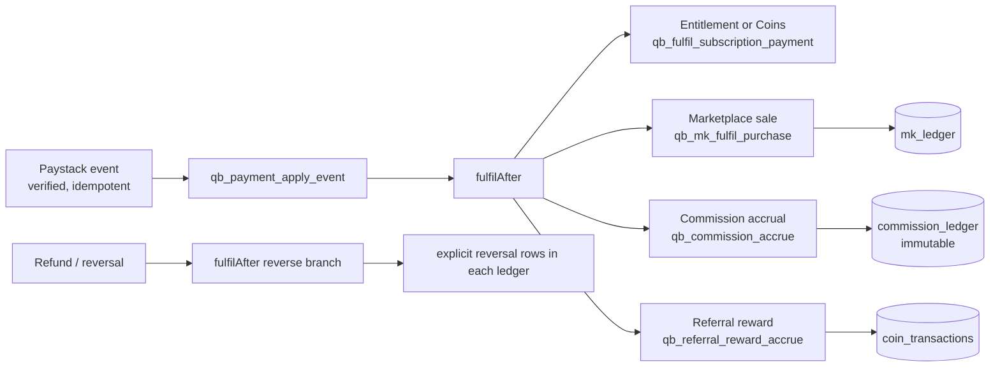

# 02. Target architecture

Date: 2026-10-25. Based on `01_CURRENT_STATE_AUDIT.md`. Rule used throughout: **extend what exists, add the smallest number of new objects, build every new engine the way the existing ones are built** (tables, checked SQL functions, row-level security, thin Next.js tier, migration + rollback + paste parts + fingerprint).

## 1. Design principles

1. **No framework or database change.** Next.js, Supabase and Paystack stay.
2. **One identity, many capabilities.** A person is one `profiles` row. Roles are capabilities held on that identity and shown through the existing workspace switcher. No second user table.
3. **One money path.** Every payment enters through `payment_intents` / `payment_events` and leaves through `fulfilAfter()`. Commissions, royalties and rewards are *consequences* of a settled payment, never separate payment flows.
4. **Separate accounting identities.** Cash receipts, tax, Coins, XP, QPoints, affiliate commission, manager commission, creator royalty, reviewer fee and prize obligation are different ledgers with different rules. They reference the same payment but never share a balance.
5. **Server-authoritative, idempotent, reversible.** Money state changes only in SECURITY DEFINER functions, keyed by payment reference or an idempotency key. Ledger rows are immutable; corrections are explicit reversal rows.
6. **Policy as versioned data, not code.** Rates, caps, hold periods, thresholds and windows live in versioned, approved policy rows. A pilot value is a configuration row marked `pilot`, never a constant.
7. **Gated by flags.** Each new commercial capability ships behind a `flags.*` setting (default off) in `platform_settings`, matching `flags.marketplace`.
8. **Minors never enter cash programmes.** Affiliate, manager and seller roles require an adult, non-managed account.

## 2. Identity, capabilities and workspaces

Current: `profiles.role` (student, teacher, admin, sponsor) plus `user_capabilities` (CHECK-listed: super_admin, content_admin, sme_reviewer, senior_sme_reviewer, competition_admin, sponsor_admin, finance_admin) and `qb_my_roles` returning the 15-value `PLATFORM_ROLES` vocabulary.

Target: keep `profiles.role` as the *primary* account type. Commercial roles are **capabilities**, granted only by staff after approval (or by a verified workflow), each with its own approval state:

| Capability / role | Held through | Grant path |
|---|---|---|
| affiliate | new `affiliates` row, `status = approved` | apply → staff approve |
| regional_manager | new `sales_agents` row bound to territories | staff appoint |
| publisher | existing `mk_sellers` (extend later to institutions / SMEs) | apply → staff verify |
| alumni_coordinator, legacy_representative | new `sponsor_programs` representatives | verified by staff against evidence |
| finance_officer, national_commercial_admin | `user_capabilities` (extend CHECK) | staff grant, second approver |
| competition_organiser | existing `competition_admin` capability and campaign ownership | existing |
| parent_guardian | existing `account_relationships` | existing, needs UI |

`user_capabilities.capability` CHECK is widened by migration only when the corresponding feature ships. Each role's screens call server functions that re-check the capability; the workspace chip is a convenience only.

**Privilege-leakage rule:** every commercial function derives the acting identity from `auth.uid()`, never from a parameter, and reads balances only for that identity unless the caller holds a finance capability.

## 3. Multi-tenancy

Existing tenancy objects: `institutions` + `institution_memberships`, `tenant_memberships`, `quizbox_competition.sponsor_organizations` + `organization_members`, `challenge_campaigns.tenant_id` (reserved, unused). Target: a single `organisations` view of three existing kinds (school, sponsor, association) is **not** created; instead each kind keeps its table and gains the fields it lacks (see §4). Cross-tenant isolation stays RLS plus checked functions that validate membership of the supplied organisation id. White-label (`tenant_id` on campaigns, brand jsonb already present on `challenge_campaigns`) remains deferred until a paying tenant exists (roadmap X9).

## 4. Domain model: reuse and additions

| Domain need (directive §2.3) | Reuse | Add |
|---|---|---|
| Users, profiles, guardians, consent | `profiles`, `account_relationships`, `learner_consent` | Guardian screens only |
| Schools, classes, teacher assignments | `institutions`, `institution_memberships`, `classes` | `institution_verifications`, `school_subscriptions` (licence: plan, seat limit, period, payer, status), `school_seats` usage view |
| Curriculum, questions, reviews | all existing | none |
| Subscriptions and entitlements | `price_list`, `learner_subscriptions`, `access_entitlements`, `qb_coin_spend` | institution entitlements (a school licence grants entitlements to members) |
| Sponsors and contracts | `sponsor_organizations`, `organization_members` | `sponsor_programs` (type: corporate / alumni / living_legacy / memorial_legacy / access), `sponsor_agreements`, `sponsor_funding` (restricted budget with released / committed / spent), `programme_representatives` |
| Competitions, rounds, entries | `challenge_campaigns`, `_stages`, `_participants`, `_prizes`, `_awards` | `challenge_campaigns.sponsor_program_id`, geographic scope, `competition_templates`, `result_verifications`, `result_appeals`, certificates |
| Alumni, legacy | none | covered by `sponsor_programs` + `programme_profiles` (authorised name, photograph reference, consent evidence) |
| Regional territories, CRM | `institutions.region/district` (free text) | `territories` (Ghana 16 regions, districts), `territory_assignments`, `crm_opportunities` (kind school / sponsor, stage), `crm_activities` (visit, demo, follow-up) |
| Affiliates, referrals | none | `affiliates`, `referral_attributions`, see §5 |
| Commission policy and accruals | none | `commission_policies` (versioned), `commission_accruals`, `commission_ledger` |
| Rewards wallet (non-cash) | `wallets`, `coin_transactions`, `qpoint_transactions` | `referral_rewards` rule rows only; Coins posted through the existing wallet functions |
| Marketplace assets and purchases | `mk_*` | `mk_royalty_policies` (versioned rates per publisher type), reviewer-fee link to `quizbox_sme` earnings |
| Payment events, settlements | `payment_intents`, `payment_events`, `refund_cases` | `settlement_batches` (reconciliation), gross / tax / fee / net on accruals |
| Prizes and fulfilment | `challenge_prizes`, `challenge_awards` | prize budget lines against `sponsor_funding` |
| Notifications, audit | `notifications`, `quizbox_core.audit` | event types only |

Every addition above is justified in the migration header that creates it (directive: document rationale, migration method, affected APIs and compatibility). Nothing in this list replaces a working object.

## 5. Unified commercial rules engine

### 5.1 Shape

`fulfilAfter()` (`lib/payments/settlement.ts`) already runs one idempotent step per consequence and answers 500 (provider retries) if any step fails. New consequences are added as further steps, each idempotent on the payment reference, so the existing retry safety carries over.

### 5.2 Money representation

All amounts are `bigint` minor units with an explicit `currency` (ISO 4217), matching `payment_intents`. Percentages are `numeric(7,4)` basis in policy rows. Rounding is `floor` in the payee's disfavour only where a policy says so, applied once per accrual and stored (never recomputed). Gross, tax, provider fee and net are stored separately on every accrual so reconciliation can show each.

### 5.3 Streams and what each pays on

| Stream | Trigger | Base | Default (pilot configuration, not live policy) |
|---|---|---|---|
| Affiliate commission | settled individual or school subscription, **first purchase** by a directly referred customer | eligible net revenue (gross − tax − refunds/discounts) | tiers 10 / 12.5 / 15 %; 30-day hold; GHS 50 minimum payout; recurring OFF |
| Regional manager commission | settled school subscription on an opportunity the manager owns | eligible net revenue | manager rate (decision D-C2) |
| Combined acquisition cap | any one sale | eligible net revenue | **15 %**, enforced when accruing (rows beyond the cap are clipped and flagged) |
| Marketplace royalty | settled marketplace sale | sale price | existing 60 / 40, moved to a versioned policy |
| Reviewer fee | completed independent review | per review | existing `compensation_policy_versions` |
| Sponsorship management fee | funded programme | funding | decision |
| Prize obligation | funded programme | restricted budget | no cash prizes before legal review |
| Coins / learning credits | qualifying direct subscriber referral | rule row | non-cash, non-transferable |

The 15 % cap applies **only** to affiliate + manager acquisition commissions. Royalties, reviewer fees and prize budgets are separate categories and are never summed into it.

### 5.4 Attribution rules (affiliate and subscriber referral)

- Server-side only; the browser stores a short opaque code in a first-party cookie for 30 days (configurable) and calls a function on sign-up or checkout.
- One attribution per customer, first-touch, immutable. Reassignment is a staff action that writes a new row and keeps the old one (audit).
- Rejected automatically: self-referral (same user, or same verified payer), a referred customer who already purchased, an affiliate who is a minor or managed learner, a suspended affiliate.
- A customer who later becomes an affiliate earns on their own sales; their original referrer earns nothing on those (no downline).
- No commission on unpaid, failed or fake subscriptions: accrual happens only from `fulfilAfter()` after `successful` settlement.
- Hold: accrual is `pending` for the hold period, then eligible for `approved` by an idempotent release function; a refund or chargeback inside or after the hold writes a reversal row (negative entry) and, if already paid, creates a recoverable balance rather than a negative payout.

### 5.5 Lifecycle models

| Object | States (service-layer function and database CHECK enforce transitions) |
|---|---|
| School onboarding | prospect → verified → subscribed → activated → renewal_due → renewed / lapsed |
| Subscription | pending → active → expiring → expired / revoked |
| Sponsor programme | draft → proposed → agreed → funded → live → delivered → reported → renewed / closed |
| Competition | draft → submitted → approved → funded → open → closed → results_verified → completed (existing LIVE/PAUSED/COMPLETED/ARCHIVED map onto this; extend, do not replace) |
| Affiliate | applied → approved → suspended / terminated (rejected) |
| Referral | pending → qualified / rejected |
| Commission | pending → approved → payable → paid; any → reversed |
| Marketplace item | draft → submitted → approved → listed → unlisted (existing) |
| Prize | pending → approved → fulfilled / disputed / cancelled |
| CRM opportunity (school) | prospect → qualified → contacted → demonstration → trial → proposal → contracted → paid → activated → renewed / lost |
| CRM opportunity (sponsor) | prospect → qualified → engagement → proposal → negotiation → contracted → funded → delivered → reported → renewed / lost |

A signed agreement is never a payment: `contracted` and `paid` are distinct states, and `activated` requires a verified payment plus real usage.

## 6. Security, privacy and safeguarding architecture

- Row-level security on every new table; direct table grants revoked from `anon` and `authenticated`; access only through functions that state their grants (the migration hygiene test enforces this).
- Payout destinations stored in a separate closed table, never selected by any browser-facing function; only a masked value is returned. Encryption at rest and a retention rule are decision D-S1.
- Sponsors and affiliates see **aggregates only**; no learner identity is exposed to them (functions return counts, never user ids). A small-population threshold suppresses groups under a configured size.
- Children: affiliate / manager / seller screens refuse minors and managed learners; child referral benefits are Coins credited to a learner wallet and require a linked adult.
- Every financial and approval action writes `quizbox_core.audit`.
- Maker–checker for payouts above a threshold and for manual ledger adjustments (reuses the pattern in the locked wallet decisions).

## 7. Feature flags and rollout

New flags (all default `false`): `flags.affiliates`, `flags.affiliate_payouts`, `flags.referral_rewards`, `flags.school_licences`, `flags.sales_crm`, `flags.sponsor_programs`, `flags.legacy_programs`, `flags.marketplace_publishers`. Code ships dark; Preview first; production switched on by the owner in Admin after the acceptance gates in `10_DEPLOYMENT_AND_ROLLBACK_PLAN.md`.

## 8. What will not be built (and why)

- A second subscription, rewards or payment engine.
- Multi-level or recruitment commissions.
- Cash prizes or chance-based promotions (legal review first).
- Recurring commissions (disabled by policy until independently evaluated).
- Live automated payouts (manual, finance-approved batches first, as the marketplace does today).
