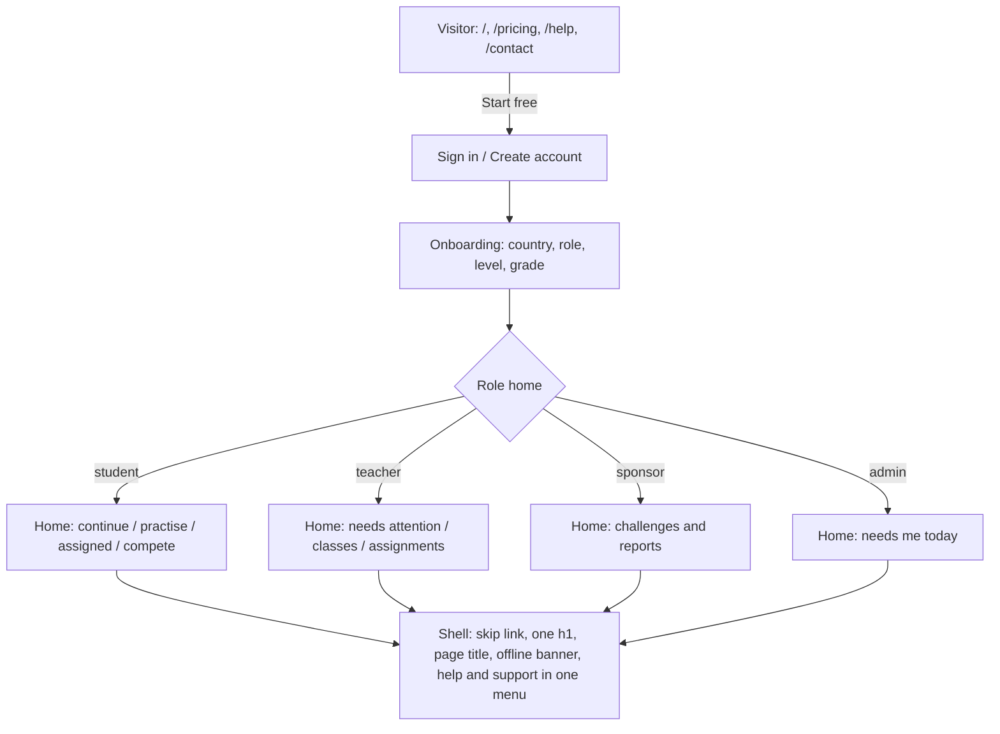
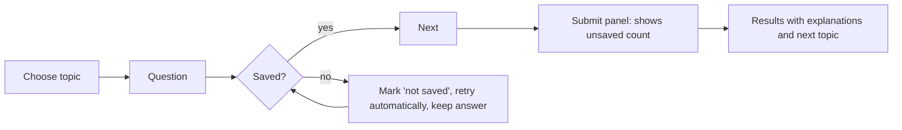

# 09 - UX redesign recommendations

Recommendations follow the evidence in 04 to 07. Each is tagged **Quick win** (hours, low risk), **Change** (days, touches several screens) or **Architecture** (weeks, needs a decision). Items that depend on signed-in behaviour are tagged **verify first**. Nothing here changes permissions, payments, migrations or approval rules.

## 1. Target UX architecture

Principle: one predictable shell, one page heading, one place to find help, and a clear "what next" on every dashboard. The current product already has most of the pieces (role colour accents, bottom navigation on phones, contextual help starter, drafts reminder). The work is consistency and recovery, not a new look.

## 2. Shell and navigation

| # | Recommendation | Tag | Evidence |
|---|---|---|---|
| 2.1 | Skip link, `document.title` per page, one `<h1>` per page (hero title becomes the h1) | Quick win | UX-003, 004, 005 |
| 2.2 | Shell-level **connection banner** ("You are offline. Changes will be saved when you reconnect.") and a shared retry button on full-page errors | Change | UX-022, 014 |
| 2.3 | One "Help and support" menu replacing separate Help and Support buttons; the Account avatar stays; remove the duplicate Account button on desktop | Quick win, **verify with users** | UX-018 |
| 2.4 | Student menu: test a single "Challenges" hub with tabs (Open, Mine, Create) beside "Compete" | Change, **validate with 5 learners first** | UX-019 |
| 2.5 | Admin menu: collapsible groups remembered per user; the home page becomes "Needs me today" (payment issues, reviews waiting, tickets, batches to approve) using counts the screens already compute | Change, **validate with 3 admins** | UX-017 |
| 2.6 | Share the identity loaded by the shell with pages (React context) | Architecture, **measure first** | UX-013 |
| 2.7 | Server-side sign-in guard on (already built) so protected URLs redirect instantly | Quick win after Preview test | UX-020 |

## 3. Learning flow (student)

- Save state per question: saved / saving / not saved, with a retry. (UX-011, **needs approval**: touches assessment integrity.)
- Resume at the first unanswered question with a "Welcome back, 4 questions left" line. (UX-012, Quick win.)
- Practice feedback already shows answer, correct answer, why and hint; keep it, and add a "Next topic to practise" suggestion on the results screen (enhancement; mastery data already exists).

## 4. Public site

- Shorten the home page: collapse "Who it is for" sections behind headings using the existing `Disclosure` component; target under 6 phone screens (now 10.7). (UX-009)
- Platform statistics: lead with content ("1,225 approved questions"), put "early pilot" before learner and school counts, keep every figure truthful. (UX-008, decision for the owner)
- Pricing: make the three audience pills real tabs so a phone shows one audience at a time (now 9 screens). Learner level (Primary / JHS / SHS) can pre-select from the signed-in profile later.
- Branded 404 with links to Home, Practise, Challenges, Help, Contact. (UX-021, Quick win)
- Contact: add a "Send a general message" jump link at the top. (UX-010)

## 5. Reusable components and design tokens

Existing: `qb-*` classes in `app/globals.css`, `qbp-*` public classes, role accent (`--role`), `PricingCards` tone map, `Disclosure`, `StatusBadge`, `ProgressCard`, `AttentionList`, `ExportLink`.

Add or extract:
| Component / token | Purpose | Why |
|---|---|---|
| `LoadError` (message + Try again + Contact support) | One full-page and one inline error state | UX-014; replaces five bare error lines |
| `ConnectionBanner` + `useOnline()` | Offline and back-online messaging | UX-022 |
| `PageTitle` / `usePageTitle()` | Sets `document.title` and renders the h1 | UX-003, 005 |
| `SaveState` badge | saved / saving / not saved per question | UX-011 |
| Contrast-safe tone tokens (`--tone-*-ink`) with a unit test | Prevent a repeat of UX-001 | UX-001 |
| Minimum target token (`--hit-min: 44px` on mobile, 24px floor) | Terms/help link spacing | UX-006 |

## 6. Workflow simplifications (admin and staff)

- Show the next step on content screens: curriculum source approved -> structure mapped -> questions loaded -> batch approved -> quality checked. A one-line "Next: Approve 2 batches" strip on each screen removes the need to remember the order (enhancement; data exists).
- Payments: schedule the Payment checks scan daily and notify finance only when something needs attention (the scan and "settle" action exist; the schedule and notice do not).
- Bulk approve for low-risk tickets and reviewer applications only after volume data shows it is needed.

## 7. Quick wins versus architectural changes

| Quick wins (a day or two, one reviewable batch) | Changes (a week) | Architecture (needs decision) |
|---|---|---|
| Titles, skip link, h1, contrast, 404, target sizes, heading order, resume at first unanswered, contact jump link | Connection banner and `LoadError`, save queue for answers, task-first admin home, menu consolidation, shortened home and tabbed pricing | Shared identity context, aligned API response shapes for mobile clients, Playwright role sweep in CI |

---

## 8. Experience standard: what "highly sought after" means, in testable rules

Added in the second pass at the owner's request (colour, button placement, fast transitions, recovery, ease of use, clarity). Each rule has a check that can be run in the sweep or in a 30-minute user test. Rules marked **(evidence)** answer a finding; the rest are standards to adopt. Nothing here has been user-tested yet; section 8.7 says how to test it.

### 8.1 Colour

| Rule | Why | Check |
|---|---|---|
| Text on any background meets 4.5:1 (3:1 only for 24 px+ or 19 px+ bold) **(evidence: UX-001)** | Readable outdoors on a cheap phone screen | axe `color-contrast` clean on every page; tone tokens carry a unit test |
| Colour carries meaning once: **blue = do this**, **green = correct / done**, **amber = needs attention**, **red = error or destructive**; the role accent is for identity only (header band, avatar ring) | A learner reads state at a glance | A style probe lists every use of green, amber and red and finds none outside its meaning |
| Never colour alone: every status has an icon or a word (the quiz already does this with Correct / Not quite) | Colour-blind users, glare | A greyscale screenshot is still readable |
| Use the existing tokens (`--blue`, `--green`, `--amber`, ...); no raw hex in components **(evidence: UX-027)** | One brand everywhere | Lint rule |
| Orange is for fills and borders, never small text; use `#c2410c` or darker for text | The pricing chips failed at 3.35:1 | Unit test over the tone map |
| Body text is `--ink` on white; muted grey only for secondary text and never below 4.5:1 | Clarity | axe |

### 8.2 Buttons and placement

| Rule | Why | Check |
|---|---|---|
| **One primary button per screen section.** Primary = solid blue; secondary = white with border; tertiary = text link; destructive = red text, solid red only inside a confirmation | The next action is obvious | A probe counts primaries per view (target 1) |
| Same size and shape everywhere: **44 px high, 10 px radius, 16 px side padding**, full width on phones below 640 px **(evidence: UX-025)** | The control is learned once | Computed-style probe identical on public, sign-in and app pages |
| Desktop forms: primary on the right, Cancel on its left. Phones: the primary is full width at the bottom of the content, within thumb reach, with the secondary below it | Matches how people hold a phone in one hand | Visual check at 390 px |
| In the quiz: **Previous on the left, Next / Submit on the right**, always in the same place; "Check answer" directly under the answer options | Muscle memory under time pressure | Positions unchanged across questions |
| Button text is verb plus object: "Start practice", "Publish assignment", "Send request", not "Submit" or "OK" | Clarity for first-time users | A small script lists generic labels |
| A disabled button says why ("Choose an answer first") | Avoids dead ends | Each disabled primary has a hint |
| Destructive and money actions have a second step that restates the consequence ("Refund GHS 40 to this buyer?") | Error prevention | Walkthrough per admin screen |
| Primary controls at least 44 x 44 px, nothing below 24 px **(evidence: UX-006)** | Fat fingers, moving buses | axe `target-size` clean |

### 8.3 Fast transitions and perceived speed

| Rule | Why | Check |
|---|---|---|
| Feedback within 100 ms: a pressed state on every button (about 120 ms colour or scale change) **(evidence: UX-026)** | The app feels alive | Every button variant has a transition and an `:active` style |
| Page change feels instant: public pages already take 66 to 219 ms; keep every signed-in route under 300 ms to first content on a mid-range phone with prefetch, cached identity and skeletons **(evidence: UX-013, UX-029)** | Perceived quality | Route timing in the sweep, per role |
| Skeletons shaped like the content, not a blank page; a signed-out visitor never sees "Loading your workspace" **(evidence: UX-020)** | No flashes | Screenshot at 150 ms and at load |
| A thin progress bar at the top when a route takes more than 300 ms | Tells slow-network users it is working | Throttled run |
| Motion budget: enter 200 ms, press 120 ms, never more than 300 ms, one easing curve; reduced motion removes movement and keeps colour changes | Quick, calm, accessible | Reduced-motion screenshot |
| First-load JavaScript on public pages under 150 KB (about 200 KB today); images lazy-loaded | Mobile data cost in Ghana | Cold-load measurement |

### 8.4 Recovery and trust

| Rule | Why | Check |
|---|---|---|
| **Nothing the user did is lost:** answers autosave with a visible state (saved, saving, not saved) and failed saves retry by themselves and on reconnect **(evidence: UX-011)** | Core promise of an assessment | Offline-then-online test passes |
| The app says when it is offline and when it is back **(evidence: UX-022)** | Honest and calm | Offline banner within 1 s |
| Every failure shows what happened in plain words, what is safe, one button to retry and one link to get help **(evidence: UX-014)** | No dead ends | Block one request: the page still shows the rest plus Try again |
| Every list has an empty state with the next action ("No assignments yet. Create one.") | Teaches the product | Empty states contain a link or button |
| Unknown addresses lead somewhere useful **(evidence: UX-021)** | Old shared links | 404 has at least 4 links |
| Resume where you left off: the first unanswered question, the draft, the last class **(evidence: UX-012)** | Respect for the user's time | Reload test |
| A 5-second Undo for reversible actions (archive, unpublish); typed confirmation only for irreversible ones | Confidence to explore | Walkthrough |

### 8.5 Ease of use and clarity

| Rule | Why | Check |
|---|---|---|
| Every screen has one **h1**, a matching tab title and a one-sentence purpose line **(evidence: UX-003, UX-005)** | Orientation | axe and title probe |
| Each dashboard starts with "what needs me now" (assignments due, payments to check, reviews waiting), then everything else **(evidence: UX-017)** | Fast for returning users | Task-time test |
| Plain words at about a Grade 8 reading level; Ghana terms (B4, JHS, SHS, GHS) used as the audience uses them; one word per concept (Coins, challenge, competition) as in `docs/ux/GLOSSARY.md` | Clarity | Glossary check script on page text |
| Forms: label above the field, example in the hint line, validation after leaving the field, errors next to the field and summarised at the top, typed values never lost | Fewer mistakes | Form walkthrough |
| Progressive disclosure: the common path visible, advanced options behind "More options" (the SME application in onboarding, advanced admin tools) | Lower cognitive load | Fewer than 7 choices per view |
| Help in context: a "?" next to complex terms (`HelpStarter` exists); Help and Support as one menu **(evidence: UX-018)** | Self-service | Test: find how to ask for help in 10 s |

### 8.6 Speed and reliability budgets (targets, not measurements)

| Metric | Target | Today (public pages, unthrottled lab) |
|---|---|---|
| LCP, mid-range Android on 4G | at most 2.0 s | 0.5 to 2.8 s across single runs |
| CLS | at most 0.05 | 0.00 |
| INP | at most 200 ms | not measured |
| Route change to first content | at most 300 ms | public 66 to 705 ms; signed-in not measured |
| Answer save | at most 500 ms, retried on failure | not measured |
| A failed or slow request without feedback | none | UX-022 and UX-011 open |
| Accessibility | axe clean; keyboard and screen-reader pass on core journeys | 4 public findings; screen reader not tested |

### 8.7 How to prove it (needed before claiming "sought after")

1. **Usability test**, remote or in person, 5 users per audience (learner on a phone, teacher, school admin, sponsor, admin), 5 tasks each, recording success, time and errors.
2. **System Usability Scale (SUS)** after each session; target 80 or more for learners and teachers.
3. **Real-device pass** on two low-cost Android phones and one iPhone, in Chrome and Samsung Internet.
4. **Weak-network pass**: a 3G profile and airplane-mode interruptions during the quiz.
5. **Live signals** after launch: task success per journey, errors per screen (the app already reports client errors to `/api/ops/client-error`), time to first answer for new learners, 7-day return rate, support requests per 100 active users.
6. **Release gate**: sweep and axe clean, offline test passes, no new P1.
